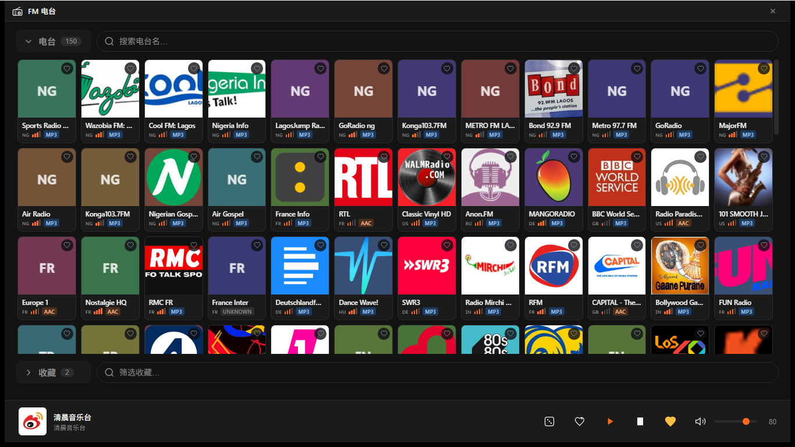

# FM 电台

[](https://apps.microsoft.com/detail/9NCZJDND65GH)
[](LICENSE)

Radio Browser 的 Windows 桌面客户端 —— 浏览全球电台目录，直接播放，无需账号。

Tauri 2 + Rust + React，音频由内置解码器流式处理，不依赖系统组件或外部播放器。




---

## 概述

[Radio Browser](https://www.radio-browser.info/) 是一个聚合了全球数千个公开电台的开放目录。本应用是它的桌面客户端：拉取目录、浏览或搜索、播放。

所有数据来自 Radio Browser 的公开 API。本应用不设服务器、不做转发、不做统计。

- **平台**：仅 Windows
- **语言**：跟随系统语言（简体中文 / English）
- **隐私**：无账号、无遥测、无广告，收藏与设置仅存本地

## 特性

- 浏览与搜索 Radio Browser 全量电台目录，按热门度、名称、标签浏览
- 收藏电台，本地保存
- 流式播放，断流自动处理
- 解析 ICY 元数据，显示电台名与当前曲名（自动处理 UTF-8 与 GB18030 编码的电台）
- 显示电台的位深、采样率、编码信息
- 随机播放（当前列表或收藏列表）
- 无边框窗口，自绘标题栏，支持贴靠
- 中英双语，跟随系统语言
- 无账号、无遥测、无广告

## 格式支持

解码由 [symphonia](https://docs.rs/symphonia) 完成，不依赖系统解码器。

| 格式 | 状态 |
| --- | --- |
| MP3 | ✅ |
| AAC / AAC+ | ✅ |
| FLAC | ✅ |
| WAV | ✅ |
| Ogg Vorbis | ✅ |
| Opus | ❌ 未启用 symphonia 的 Opus 解码器 |

> 电台实际使用什么格式由电台方决定。目录里标注的编码信息仅供参考，部分电台标注与实际流不一致。

## 下载

通过 Microsoft Store 获取（Windows 10 1809 / 11 及以上）：

<https://apps.microsoft.com/detail/9NCZJDND65GH>

## 从源码构建

### 前置条件

- Windows 10 1809 或更高
- [Rust](https://rustup.rs/) stable（edition 2021）
- [Node.js](https://nodejs.org/) 18 或更高
- Visual Studio Build Tools 的「使用 C++ 的桌面开发」工作负载
- Windows SDK（含 `makepri` / `makeappx`，仅打 MSIX 时需要）

### 构建

**前端必须先于 Rust 构建。** Tauri 在编译期把 `dist/` 整个嵌入二进制，顺序反了会打进旧前端，而且不会报错。

```sh
npm install && npm run build
cd src-tauri && cargo build --release --features custom-protocol
```

产物：`src-tauri\target\release\fm-radio.exe`

`--features custom-protocol` 不能省 —— 它决定 Tauri 读取打包资源还是去连开发服务器。

### 测试

在 `src-tauri/` 下执行：

```sh
cargo test
cargo clippy --all-targets -- -D warnings
cargo fmt --check
```

### 打包 MSIX

包源在 `msix/`（清单、图标、资源字符串），脚本在 `tools/`。发新版的完整步骤：

```powershell
npm install && npm run build
cd src-tauri && cargo build --release --features custom-protocol && cd ..
.\tools\New-MsixPackage.ps1 -Version "0.2.0.0"
```

产物在 `msix\build\`，上传到 Partner Center 的「管理程序包」。版本号必须高于已发布版本。

商店文案与素材清单见 [docs/store-submission.md](docs/store-submission.md)。

## 技术栈

| 层 | |
| --- | --- |
| 界面 | React 18 + TypeScript + Vite |
| 容器 | Tauri 2 |
| 后端 | Rust（edition 2021） |
| 音频 | symphonia 解码 + rodio 输出 |
| 网络 | reqwest（rustls） |

## 隐私

本应用不收集任何数据：无账号、无标识符、无遥测、无广告。收藏与设置保存在本机。

点击播放前不会向任何电台发起请求；开始播放后仅向所选电台的服务器请求音频流，并向 Radio Browser 的公开 API 请求目录数据。

完整说明见 [docs/privacy](docs/privacy/index.html)。

## License

[MIT](LICENSE)