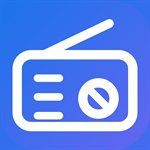

# Microsoft Store 提交材料

包名 / Package identity: `com.fmradio.app`
发布者 / Publisher: **Ray Digital**
Seller ID: `96541170`
隐私政策 / Privacy policy: `https://gh-ryan.github.io/fm-radio-rust/privacy/`

素材在 `store-assets/`。截图是中文界面（系统语言为中文）；英文 listing 需重新拍摄或改系统语言后重拍。

## 0. 预览

**Screenshots**（1366×768，上限 10 张，最少 1 张）

| | |
| --- | --- |
|  |  |
| 1. 浏览 | 2. 正在播放 |

**Logos**

| 300×300 tile | 310×310 | 150×150 | Splash 620×300 |
| --- | --- | --- | --- |
|  |  |  |  |

> 上图仅供参考尺寸比例，实际提交的是这些文件本身，不是拼图。

**上传商店 vs 打进安装包** —— 目录里有两类，用途不同：

| 上传到 Store listing | 只打进 MSIX 包（Windows 从包内读取） |
| --- | --- |
| `Screenshot-*.png` | `Square44x44Logo.png`（任务栏） |
| `StoreLogo-300x300.png` | `Square71x71Logo.png` |
| `Square310x310Logo.png`（可选，覆盖包内） | `Square150x150Logo.png` |
| | `StoreLogo.png` |
| | `LockScreenLogo.png` |
| | `Wide310x150Logo.png` |
| | `SplashScreen.png` |

---

## 1. 应用名称 / App name

| 语言 | 名称 |
| --- | --- |
| zh-CN | FM 电台 |
| en-US | FM Radio |

## 2. 描述 / Description

### zh-CN

全球网络电台，点开即听。

· 数万个电台，可按台名或国家搜索
· 直接流式播放，无需下载，不依赖外部播放器
· 收藏常听的电台，下次打开还在
· 每张卡片显示台标、所在国家、编码格式和信号强度
· 免费，无广告，无内购

电台目录来自 Radio Browser 开放平台。

### en-US

Internet radio from around the world. Click and listen.

· Tens of thousands of stations, searchable by name or country
· Streams directly — nothing to download, no external player
· Save favourites for next time
· Every card shows the logo, country, codec, and signal strength
· Free. No ads. No in-app purchases.

Station directory provided by Radio Browser.

## 3. 截图说明 / Screenshot captions

上限 200 字符 / 200 characters max.

| # | 图片 | zh-CN | en-US |
| --- | --- | --- | --- |
| 1 |  | 浏览电台目录，每张卡片显示台标、所在国家、编码格式和信号强度。 | Browsing the station directory. Every card shows the logo, country, codec, and signal strength. |
| 2 |  | 正在播放，底部播放条显示电台名与采样率，可收藏、暂停、调节音量。 | Now playing. The player bar shows the station name and sample rate, with favourite, pause, and volume. |

## 4. 关键词 / Keywords

- zh-CN：`电台,广播,收音机,网络电台,在线广播,音乐,音乐播放器,Radio Browser`
- en-US：`radio,broadcast,internet radio,online radio,music,music player,stream,Radio Browser`

## 5. 其他字段 / Other fields

| 字段 | 值 |
| --- | --- |
| Category | Music（若下拉无此项，选 closest 的 Media / Entertainment） |
| Pricing | Free |
| Markets | 全部 / All |
| Audience | Public |
| Discoverability | 可在 Store 中被发现 |
| Website | 留空 —— 官方标注 Not required |
| Support contact | 留空 —— 仅 Xbox 上架时必填 |
| Age ratings | 逐题作答，见下 |

## 6. 年龄分级 / Age ratings

问卷每题都必填。本应用的答案：

| 题 | 答 |
| --- | --- |
| 使用频率 / Frequency | 不常使用 / Infrequent |
| 血腥、暴力、恐怖元素 / Violence | 无 / None |
| 恐怖、惊悚元素 / Fear | 无 / None |
| 暴力、伤害、血腥 / Gore | 无 / None |
| 裸露或暗示性内容 / Nudity | 无 / None |
| 性内容或暗示 / Sexuality | 无 / None |
| 脏话 / Profanity | 无 / None |
| 酒精、烟草、毒品 / Mature content | 无 / None |
| 用户互动 / User interaction | 无 —— 应用内无聊天、无 UGC 发布 |
| 用户生成内容 / User-generated content | 无 —— 只读目录，不发布内容 |
| 位置信息 / Location | 否 / No |
| 应用内购买 / In-app purchases | 无 / None |
| 广告 / Ads | 无 / None |

若问卷出现"是否会收集用户数据"一题，选 **否 / No**：无账号、无标识符、无遥测，用户数据仅存本地。

---

## 待解决 / Open issues

- **`ms-resource` 本地化写法**：清单里显示名仍是字面量「FM 电台」，中英文未区分。三种写法都过不了 makeappx schema，尚未解决。
- **英文截图**：当前素材为中文界面。提交英文 listing 时需重拍，否则中英 listing 混用中文截图。
- **Publisher DN**：清单里是 `CN=GH-Ryan`，与商店发布者 `Ray Digital` 不同名。提交时需确认 Partner Center 是否接受（商店分发会由微软重签）。