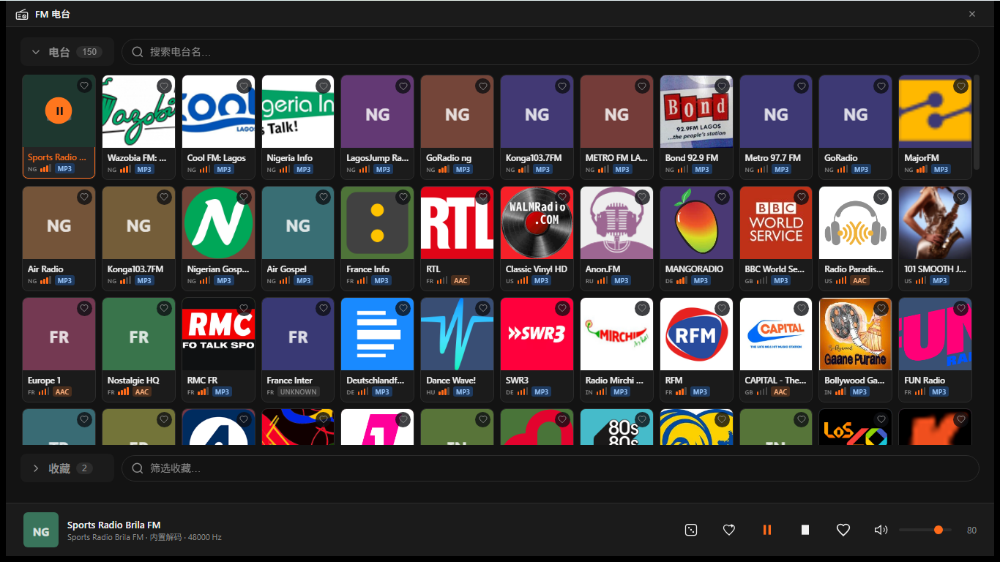
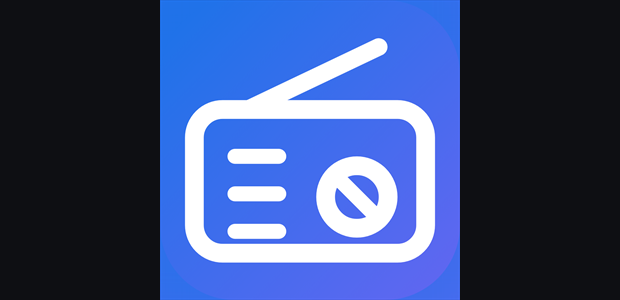

# Microsoft Store 提交材料

| | |
| --- | --- |
| Store ID | `9NCZJDND65GH` |
| 包标识 / Package identity | `RayDigital.FM` |
| 发布者 DN / Publisher | `CN=3795FA3D-F467-470E-B67A-65A8BC923C67` |
| 发布者显示名 / Publisher display name | **Ray Digital** |
| Seller ID | `96541170` |
| 隐私政策 / Privacy policy | `https://gh-ryan.github.io/fm-radio-rust/privacy/` |
| Store 链接 | `https://apps.microsoft.com/detail/9NCZJDND65GH` |

前三项由 Partner Center 分配，可在产品的 **Product identity** 页查到，且必须与
`Package.appxmanifest` 里的 `Identity` 完全一致，否则包校验失败。

素材在 `../assets/`。截图分中英两套（`-zh` / `-en`），分别上传到对应语言的 listing。

## 0. 预览

**Screenshots**（1366×768，上限 10 张，最少 1 张）

| | |
| --- | --- |
|  |  |
| 1. 浏览 | 2. 正在播放 |

**Logos**

| 300×300 tile | 310×310 | 150×150 | Splash 620×300 |
| --- | --- | --- | --- |
|  |  |  |  |

> 上图仅供参考尺寸比例，实际提交的是这些文件本身，不是拼图。

**上传商店 vs 打进安装包** —— 两类素材分开放，互不混入：

| `assets/`（上传到 Store listing） | `msix/Assets/`（打进包，Windows 从包内读） |
| --- | --- |
| `Screenshot-*.png` | `StoreLogo.png` |
| `Square300x300Logo.png` | `Square44x44Logo.png`（任务栏） |
| | `Square71x71Logo.png` |
| | `Square150x150Logo.png` |
| | `Square310x310Logo.png`（也可上传 listing） |
| | `LockScreenLogo.png` |
| | `Wide310x150Logo.png` |
| | `SplashScreen.png` |

`src-tauri/icons/` 是第三类 —— Tauri 应用图标，`icon.ico` 编译进 exe 决定窗口与任务栏图标，
`icon-1024.png` 是上面所有素材的生成源。三者都由 `tools/New-StoreAssets.ps1` /
`tools/New-OpaqueIco.ps1` 从矢量图生成。

---

## 1. 应用名称 / App name

| 语言 | 名称 |
| --- | --- |
| zh-CN | FM 电台 |
| en-US | FM Radio |

## 2. 描述 / Description

### zh-CN

全球网络电台，点开即听。

· 数万个电台，可按台名或国家搜索
· 直接流式播放，无需下载，不依赖外部播放器
· 收藏常听的电台，下次打开还在
· 每张卡片显示台标、所在国家、编码格式和信号强度
· 免费，无广告，无内购

电台目录来自 Radio Browser 开放平台。

### en-US

Internet radio from around the world. Click and listen.

· Tens of thousands of stations, searchable by name or country
· Streams directly — nothing to download, no external player
· Save favourites for next time
· Every card shows the logo, country, codec, and signal strength
· Free. No ads. No in-app purchases.

Station directory provided by Radio Browser.

## 3. 截图说明 / Screenshot captions

上限 200 字符 / 200 characters max.

| # | 图片 | zh-CN | en-US |
| --- | --- | --- | --- |
| 1 |  | 浏览电台目录，每张卡片显示台标、所在国家、编码格式和信号强度。 | Browsing the station directory. Every card shows the logo, country, codec, and signal strength. |
| 2 |  | 正在播放，底部播放条显示电台名与采样率，可收藏、暂停、调节音量。 | Now playing. The player bar shows the station name and sample rate, with favourite, pause, and volume. |

## 4. 关键词 / Keywords

- zh-CN：`电台,广播,收音机,网络电台,在线广播,音乐,音乐播放器,Radio Browser`
- en-US：`radio,broadcast,internet radio,online radio,music,music player,stream,Radio Browser`

## 5. 其他字段 / Other fields

| 字段 | 值 |
| --- | --- |
| Category | Music（若下拉无此项，选 closest 的 Media / Entertainment） |
| Pricing | Free |
| Markets | 全部 / All |
| Audience | Public |
| Discoverability | 可在 Store 中被发现 |
| Website | 留空 —— 官方标注 Not required |
| Support contact | 留空 —— 仅 Xbox 上架时必填 |
| Age ratings | 逐题作答，见下 |

## 6. 年龄分级 / Age ratings

IARC 问卷分两步。第一步选 App Type，三选一：

| 选项 | 适用 |
| --- | --- |
| Game | 游戏或博彩类 |
| Social or Communication | 主要用途是社交或通讯 |
| **All Other App Types** | **本应用选这项** |

选定后才会渲染后续题目，全部选最低档：

| 题 | 答 |
| --- | --- |
| Downloaded App —— 包内是否含分级相关内容 | No |
| User Content Sharing —— 用户间能否交换内容 | No |
| Online Content —— 是否展示或推广非初始下载内的内容 | No |
| Promotion or Sale of Age-Restricted Products | No |
| 是否与他人共享用户精确位置 | No |
| 是否允许购买数字商品 | No |
| 是否含现金奖励、礼品卡、play-to-earn、加密货币或 NFT | No |
| 是否为浏览器或搜索引擎 | No |
| 是否为新闻或教育类产品 | No |
| 是否使用评级机构直接颁发的评级 / 是否通过实体介质分发 | No |

另有一个独立选项「I'm ready to complete the IARC questionnaire」需选中，否则题目不渲染。